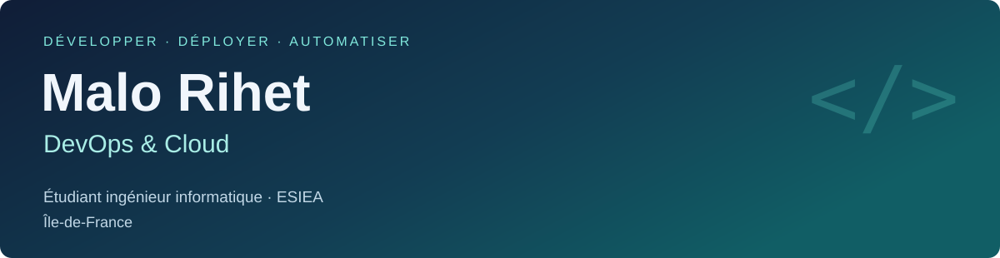

<picture></picture>

Du développement d’applications aux environnements Linux et cloud, j’aime comprendre comment les systèmes fonctionnent ensemble.

[LinkedIn ↗](https://www.linkedin.com/in/malo-rihet) · [Explorer mes dépôts](https://github.com/malo-perso?tab=repositories)

## 🧩 Mon environnement

<picture></picture>

Azure **AZ-900 et AZ-104** : préparation en cours.

## 🚀 Projets à découvrir

| Projet | Présentation |
| :--- | :--- |
| **Arcadia** · Privé | Borne d’arcade sur Raspberry Pi. **Python · Linux · SQLite**. Projet personnel en cours de développement. |
| **CineCanva** · Privé | Application de suivi de films, séries et animés. **React Native · Django · Neo4j · Azure**. Projet en binôme destiné à être commercialisé. |
| **[webFr ↗](https://github.com/malo-perso/webFr)** | Prototype de collecte de liens du web français. **Java · HTTP · Concurrence**. [Rapport de conception](https://github.com/malo-perso/webFr/blob/main/RAPPORT.md) disponible. |
| **[Les Aventuriers du Rail ↗](https://github.com/malo-perso/LesAventuriersDuRail)** | Projet de BUT inspiré du jeu de société : interface graphique et modélisation objet. **Java · Swing**. |

Les dépôts d’Arcadia et de CineCanva restent privés ; leur code n’est pas accessible depuis ce profil.

---

**BUT Informatique · IUT du Havre** → **Cycle ingénieur · ESIEA, 2026–2029**

Île-de-France · [Échanger sur LinkedIn ↗](https://www.linkedin.com/in/malo-rihet)
